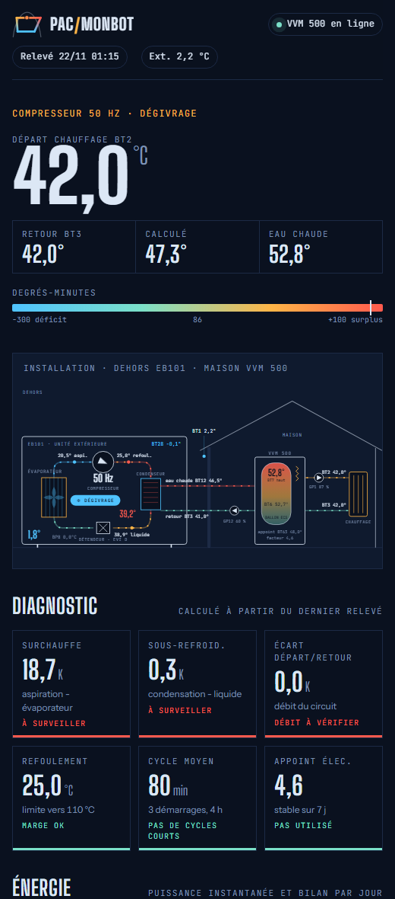

# pac: live dashboard for NIBE heat pumps (myUplink)

A self-hosted, real-time dashboard for **NIBE heat pumps** connected to **myUplink**.


It shows:
- an installation schematic (outdoor unit, indoor module, water circuits). It is animated in proportion to the compressor frequency and switches to a reversed cycle during defrost;
- the refrigerant cycle: suction and discharge temperatures, superheat and subcooling;
- flow and return temperatures against the heating curve, degree-minutes and the electric backup heater;
- electrical power, heat produced, COP and a 14-day energy balance from the NIBE energy log;
- charts with a draggable time brush (6 h, 24 h, 7 d, 30 d, all), plus a 30-day outdoor temperature band.
- hover any chart to read the exact values under the cursor;
- in the private area only: an electricity cost board (today, yesterday, 7 days, month to date with an end-of-month projection, 30-day bars split peak / off-peak, whole-house estimate).

| Schematic while running (`?demo=64`) | Phone, defrost (`?demo=defrost`) |
|---|---|
|  |  |

The page has no front-end dependencies: plain HTML, CSS and hand-drawn SVG, with local fonts and a strict CSP. The **free myUplink plan is enough**, because the history is built by the collector itself.

You can run it in two ways, both using the same `src/worker.js`:
- on **Cloudflare** (Workers + D1 + cron trigger), see option A;
- on **any VM or server** (Node ≥ 22.5 with built-in SQLite, or Docker / Podman), see option B.

> **Compatibility.** The point IDs (`TRACKED` in `src/worker.js`, `ID` at the top of `site/app.js`) were checked on a **NIBE VVM 500 indoor module with an EB101 outdoor unit** (F2120). Other NIBE models (S-series, F-series, SMO) expose most of the same points, but some numbers may differ. The `points` table stores every point your system reports, so compare against it and adjust the two lists if a value stays empty.
>
> The user interface is in French for now. Labels are in `site/index.html` and `site/app.js`.

## 1. myUplink access (both options)

1. Create an application at https://dev.myuplink.com/apps (client credentials). The callback URL can stay empty.
2. Keep the **Client ID** and **Client Secret** out of git:
   - on Cloudflare, store them as Wrangler secrets;
   - on a VM, put them in a `.env` file, which is already git-ignored.

The collector only uses the `READSYSTEM` scope, which is read-only. It makes about 3 requests every 5 minutes, well under the myUplink quota of 25 requests per minute.

## A. Deploy on Cloudflare

```sh
cp wrangler.example.jsonc wrangler.jsonc        # then set your hostname
npx wrangler d1 create pac                      # paste the database ID into wrangler.jsonc
npx wrangler d1 migrations apply pac --remote
npx wrangler secret put MYUPLINK_CLIENT_ID
npx wrangler secret put MYUPLINK_CLIENT_SECRET
npx wrangler deploy
```

The first data point arrives within 5 minutes.

### Public page + private area (Cloudflare Access)

The root page is public and never includes the house phase currents (BE1 to BE3), because they reveal when people are home. The same dashboard with those values lives under `/prive/`, protected by Cloudflare Access:

1. In the Cloudflare dashboard, go to **Zero Trust → Access controls → Applications → Create new application → Self-hosted**.
2. Set the **destination** to your hostname with the path `prive`.
3. Add a **policy**: Allow, `Emails` equal to the addresses you want.
4. For the **login method**, use One-time PIN (a code sent by email): it is built in, with no OAuth app to create. Google or GitHub also work.
5. Put your team name and the application's AUD tag in `wrangler.jsonc`: `"vars": { "ACCESS_TEAM": "...", "ACCESS_AUD": "..." }`. The AUD tag is shown in the app's settings, or as `kid=` in the login redirect URL.

The Worker then checks the `Cf-Access-Jwt-Assertion` token itself before serving the private data: RS256 signature, issuer, audience and expiry. If Access is misconfigured, `/prive/` returns 403 instead of leaking data.

To protect the whole site instead, leave the Access path empty.

### Electricity cost (private area)

The cost board uses the NIBE energy log (heat pump consumption per hour, backup heater included) and the house phase currents. Set your tariff in `vars` (Cloudflare) or `.env` (VM):

| Variable | Meaning |
|---|---|
| `PRICE_KWH` | Price per kWh, base tariff or peak hours (default 0.1952) |
| `PRICE_HC` | Optional off-peak price per kWh |
| `HC_HOURS` | Off-peak local hours, e.g. `22-6` or `23:30-7:30,12-14` (half-hour precision) |
| `MONTHLY_FEE` | Optional fixed monthly fee incl. VAT (subscription, network capacity, metering), added to the month projection |
| `TIMEZONE` | Time zone for days and off-peak hours (default `Europe/Paris`) |

Use all-in prices (energy, network, taxes, VAT). Per-kWh amounts exclude fixed fees; set `MONTHLY_FEE` to include them in the month projection. Example for Luxembourg (Enovos + Creos, 2026): (energy 0.1321 + Creos network 0.0510 + electricity tax 0.0010 - compensation 0.0010) × 1.08 VAT ≈ 0.1978 €/kWh, `TIMEZONE=Europe/Luxembourg`, no off-peak hours. Creos capacity overrun charges are computed when Leneda data is available (see below).

### Luxembourg: real consumption from Leneda

[Leneda](https://www.leneda.lu) is the national metering data platform. With it, the house figure comes from the Smarty meter itself (15-minute average power, OBIS `1-1:1.29.0`) instead of the phase-current estimate. You also get the daily 15-minute peak and, with `PREF_KW` and `OVERRUN_KWH`, the cost of energy drawn above your reference power.

1. In https://app.leneda.eu, add your metering point (POD code from your bill; approval can take a few business days).
2. In *My profile → API keys*, create a key. It is shown only once.
3. Store the three values as secrets: `npx wrangler secret put LENEDA_API_KEY`, then `LENEDA_ENERGY_ID` and `LENEDA_POD` (or put them in `.env` on a VM).
4. Apply the new migration: `npx wrangler d1 migrations apply pac --remote`.

The collector calls Leneda at most once an hour and re-reads the last 3 days, since the data is published with a delay. The first call loads the last 62 days. `/api/health` shows the last Leneda HTTP status. While a day is not fully published, the house figure for that day falls back to the phase estimate. The whole-house figure is an estimate: phase currents × 230 V, so apparent power without power factor. `/api/cost` only answers under `/prive/` (or with `SHOW_HOUSE=1`).

Keep `workers_dev: false`, otherwise the `*.workers.dev` URL would bypass Access.

## B. Run on a VM or server

With Node ≥ 22.5 (no `npm install` needed):

```sh
cp .env.example .env      # fill in MYUPLINK_CLIENT_ID / SECRET
npm start                 # http://127.0.0.1:8787, data in ./data/pac.db
```

With Docker or Podman:

```sh
cp .env.example .env
docker compose up -d      # or: podman compose up -d
```

`server/node.mjs` provides what Cloudflare would:
- it applies the migrations at startup;
- it collects every 5 minutes (`POLL_MINUTES`; `0` disables collection);
- it serves `site/` with the headers from `site/_headers`;
- it caches API responses for 60 seconds.

There is **no built-in login**, and the server listens on `127.0.0.1` only. To reach it from outside, use one of:
- `cloudflared tunnel` with Cloudflare Access;
- a reverse proxy with authentication (Caddy, nginx);
- your VPN or Tailscale only.

## API (GET only)

| Route | Returns |
|---|---|
| `/api/now` | Latest values, 7-day counters, active alarms (severity and title), collector status |
| `/api/series?range=24h\|7d\|30d\|30dd\|365d\|all&pids=…`, or `from=&to=` (UTC seconds) | Aggregated series, about 400 points per series at most, 12 series at most |
| `/prive/api/cost` | Private: kWh per local day (peak / off-peak, house estimate) and the tariff, last 62 days |
| `/api/health` | Last 12 collections, myUplink history-route probe |

## Security

- No secrets live in the code. The myUplink token is cached in the database and never returned by the API.
- The API does not expose the full point list or the system and device IDs. House phase currents are only served under `/prive/` with a verified Access token, or everywhere with `SHOW_HOUSE=1` (VM mode behind your own authentication).
- On Cloudflare, each IP is limited to 60 requests per minute. A myUplink 429 pauses collection according to `RateLimit-Reset`.
- The page uses a strict CSP (`site/_headers`), with no third-party scripts, fonts or CDNs.
- Long ranges read hourly aggregates from `readings_h` instead of the raw readings.

## Notes

- Add `?demo=30|64|110|defrost` to the URL to preview the animated schematic when the compressor is idle. It changes the display only.
- Energy figures come from the NIBE energy log: point 32486 for instantaneous power, 3249x for last-hour totals. Without them, the fallback estimate is 40 W per Hz.
- On the free myUplink plan, the history route returns 403, so past data cannot be imported without Premium.
- This project is not affiliated with NIBE or myUplink.

MIT licence.
