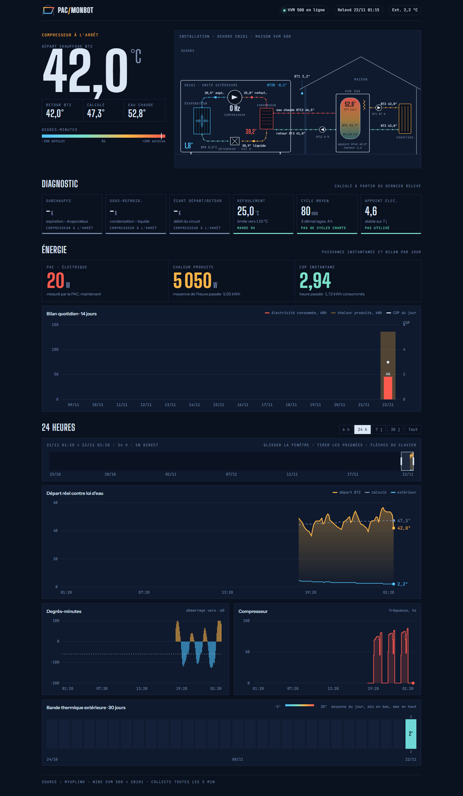
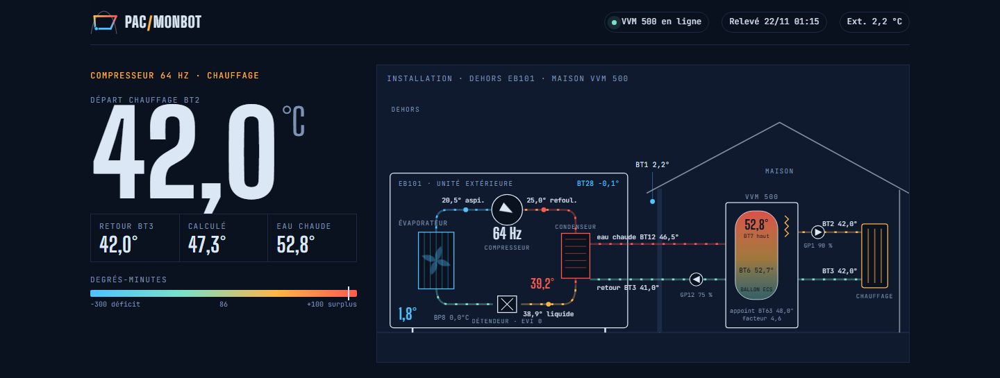

# PAC/POWER: NIBE heat pump and home electricity dashboard (myUplink)

A self-hosted, real-time dashboard for a **NIBE heat pump** connected to **myUplink**, and for the **electricity consumption of the home** around it: what the heat pump uses, what the whole house draws from the meter, what it costs per tariff band, and when something needs attention.



It shows:
- an installation schematic (outdoor unit, indoor module, water circuits). It is animated in proportion to the compressor frequency and switches to a reversed cycle during defrost;
- the refrigerant cycle: suction and discharge temperatures, superheat and subcooling;
- flow and return temperatures against the heating curve, degree-minutes and the electric backup heater;
- electrical power, heat produced, COP and a 14-day energy balance from the NIBE energy log;
- charts with a draggable time brush (6 h, 24 h, 7 d, 30 d, all), plus a 30-day outdoor temperature band.
- hover any chart to read the exact values under the cursor;
- in the private area only: an **Analysis** tab (`/prive/analyse`): cost and kWh per tariff band for the house and the heat pump, average hourly profile (weekday / weekend), energy sharing gain or loss per band, 15-minute peak histogram against the reference power, monthly table, and what-if simulations (shifting load out of peak hours, reference power);
- in the private area only: an electricity cost board (today, yesterday, 7 days, month to date with an end-of-month projection, 30-day bars split peak / off-peak, whole-house consumption from the meter or estimated from the phase currents);
- in the private area only: a **Costs** tab (`/prive/couts`): real cost of the period, comparison with other offers (single price, peak / off-peak, and the market offers read from the official ILR Calculix comparison tool, each recalculated on your own quarter-hour consumption), a reference power (subscription) simulation, an energy community simulation, and a solar panel simulation with optional grid injection;
- six display themes (night, day, high contrast, neumorphism, glassmorphism, cyber-brutalism), on every page, chosen from small swatches in the top bar and remembered in the browser;
- a public **Calculator** (`/calculateur`): type your annual consumption and reference power, and compare the yearly cost of every electricity offer on the Luxembourg market (Creos grid), from the dated Calculix snapshot;
- in the private area only: an **alerts** panel at the top of the page, with a red status dot in the header. It lists active NIBE alarms (myUplink notifications), alarm codes reported by the modules (outdoor unit EB101, EB100, VVM 500), and API key or data-feed problems: myUplink key rejected, collection stopped, quota exceeded, Leneda key rejected, Leneda push from the home PC stopped, push token rejected.

| Schematic while running (`?demo=64`) | Phone, defrost (`?demo=defrost`) |
|---|---|
|  |  |

The page has no front-end dependencies: plain HTML, CSS and hand-drawn SVG, with local fonts and a strict CSP. The **free myUplink plan is enough**, because the history is built by the collector itself.

You can run it in two ways, both using the same `src/worker.js`:
- on **Cloudflare** (Workers + D1 + cron trigger), see option A;
- on **any VM or server** (Node ≥ 22.5 with built-in SQLite, or Docker / Podman), see option B.

> **Compatibility.** The point IDs (`TRACKED` in `src/worker.js`, `ID` at the top of `site/app.js`) were checked on a **NIBE VVM 500 indoor module with an EB101 outdoor unit** (F2120). Other NIBE models (S-series, F-series, SMO) expose most of the same points, but some numbers may differ. The `points` table stores every point your system reports, so compare against it and adjust the two lists if a value stays empty.
>
> The user interface is in French, English and German (see Notes).

## 1. myUplink access (both options)

1. Create an application at https://dev.myuplink.com/apps (client credentials). The callback URL can stay empty.
2. Keep the **Client ID** and **Client Secret** out of git:
   - on Cloudflare, store them as Wrangler secrets;
   - on a VM, put them in a `.env` file, which is already git-ignored.

The collector only uses the `READSYSTEM` scope, which is read-only. It makes about 3 requests every 5 minutes, well under the myUplink quota of 25 requests per minute.

## A. Deploy on Cloudflare

```sh
cp wrangler.example.jsonc wrangler.jsonc        # then set your hostname
npx wrangler d1 create pac                      # paste the database ID into wrangler.jsonc
npx wrangler d1 migrations apply pac --remote
npx wrangler secret put MYUPLINK_CLIENT_ID
npx wrangler secret put MYUPLINK_CLIENT_SECRET
npx wrangler deploy
```

The first data point arrives within 5 minutes.

### Public page + private area (Cloudflare Access)

The root page is public and never includes the house phase currents (BE1 to BE3), because they reveal when people are home. The same dashboard with those values lives under `/prive/`, protected by Cloudflare Access:

1. In the Cloudflare dashboard, go to **Zero Trust → Access controls → Applications → Create new application → Self-hosted**.
2. Set the **destination** to your hostname with the path `prive`.
3. Add a **policy**: Allow, `Emails` equal to the addresses you want.
4. For the **login method**, use One-time PIN (a code sent by email): it is built in, with no OAuth app to create. Google or GitHub also work.
5. Put your team name and the application's AUD tag in `wrangler.jsonc`: `"vars": { "ACCESS_TEAM": "...", "ACCESS_AUD": "..." }`. The AUD tag is shown in the app's settings, or as `kid=` in the login redirect URL.

The Worker then checks the `Cf-Access-Jwt-Assertion` token itself before serving the private data: RS256 signature, issuer, audience and expiry. If Access is misconfigured, `/prive/` returns 403 instead of leaking data.

To protect the whole site instead, leave the Access path empty.

### Electricity cost (private area)

The cost board uses the NIBE energy log (heat pump consumption per hour, backup heater included) and the house phase currents. Set your tariff in `vars` (Cloudflare) or `.env` (VM):

| Variable | Meaning |
|---|---|
| `PRICE_KWH` | Price per kWh, base tariff or peak hours (default 0.1952) |
| `PRICE_HC` | Optional off-peak price per kWh |
| `HC_HOURS` | Off-peak local hours, e.g. `22-6` or `23:30-7:30,12-14` (half-hour precision) |
| `MONTHLY_FEE` | Optional fixed monthly fee incl. VAT (subscription, network capacity, metering), added to the month projection |
| `SHARED_KWH` | Optional all-in price per kWh covered by an energy community (Luxembourg, via Leneda) |
| `ENERGY_BANDS` | Line-by-line mode, takes precedence over `PRICE_KWH`: supplier energy price excl. VAT per local hour band, e.g. `wd:0-6=0.09213,6-17=0.13213,17-24=0.14213;we:...` (`wd` Monday to Friday, `we` weekend, `all` every day) |
| `TAX_KWH`, `COMPENSATION_KWH` | Line-by-line mode: per-kWh taxes on the kWh bought from the supplier (the compensation can be negative) |
| `NETWORK_KWH`, `VAT` | Line-by-line mode: network charge on all consumption (shared kWh included), and the VAT rate (e.g. `0.08`) |
| `SHARED_ENERGY_KWH`, `SHARED_VAT` | Line-by-line mode: price per kWh billed by the energy community, and its VAT rate; the network charge is added on top |
| `TIMEZONE` | Time zone for days and off-peak hours (default `Europe/Paris`) |

Use all-in prices (energy, network, taxes, VAT). Per-kWh amounts exclude fixed fees; set `MONTHLY_FEE` to include them in the month projection. For a time-of-use contract, prefer the line-by-line mode (`ENERGY_BANDS` and the variables below it): it follows the invoice line by line and was checked against a real Luxembourg invoice (Enovos "naturstroum drive" + Creos network, September 2026) to the cent. `TIMEZONE=Europe/Luxembourg` in that case. `PREF_KW` (reference power) and `OVERRUN_KWH` (price per kWh above it) are optional; leave `OVERRUN_KWH` unset if your invoice has no overrun line, and the 15-minute peak is still shown.

### Luxembourg: real consumption from Leneda

[Leneda](https://www.leneda.lu) is the national metering data platform. With it, the house figure comes from the Smarty meter itself (15-minute average power, OBIS `1-1:1.29.0`) instead of the phase-current estimate. You also get the daily 15-minute peak and, with `PREF_KW` and `OVERRUN_KWH`, the cost of energy drawn above your reference power.

1. In https://app.leneda.eu, add your metering point (POD code from your bill; approval can take a few business days).
2. In *My profile → API keys*, create a key. It is shown only once.
3. Store the three values as secrets: `npx wrangler secret put LENEDA_API_KEY`, then `LENEDA_ENERGY_ID` and `LENEDA_POD` (or put them in `.env` on a VM).
4. Apply the new migration: `npx wrangler d1 migrations apply pac --remote`.

**Leneda blocks requests from outside Luxembourg** (tested: Cloudflare Workers and an OVH server in France get 403 even with a wrong key, while a Luxembourg connection gets 401). So the data is fetched from a machine in Luxembourg and pushed to the Worker:

1. Generate a random token and store it as a Worker secret: `npx wrangler secret put INGEST_TOKEN`.
2. On the Luxembourg machine, create `leneda.env` (git-ignored) with `LENEDA_API_KEY`, `LENEDA_ENERGY_ID`, `LENEDA_POD`, `PUSH_URL=https://<your host>/api/ingest/grid` and the same `INGEST_TOKEN`.
3. Run `node --env-file=leneda.env server/leneda-push.mjs` every hour (cron, Windows Task Scheduler). The first run loads 62 days; later runs re-read the last 3 days, so a machine that was off catches up.

**Energy communities** (for example WattSwap): the push script also reads the share of your consumption covered by energy sharing (`1-65:1.29.2` local community, `1-65:1.29.4` national community, summed). Leneda publishes it about a month late; the script re-reads it once a day. Set `SHARED_KWH` to the all-in price per shared kWh (community energy price + network + taxes, VAT included): that share is then billed at this price instead of `PRICE_KWH`. Days whose sharing is not published yet are shown as such and billed at `PRICE_KWH`. Disable with `SHARED=0` in `leneda.env`.

`POST /api/ingest/grid` only writes: it checks the token in constant time, accepts at most 10,000 quarter-hours in kW, and returns no data. When `INGEST_TOKEN` is set, the Worker stops calling Leneda itself. If you are lucky enough that Leneda accepts your server, set only the three Leneda secrets and the Worker collects hourly on its own. Either way, a day that is not fully published yet falls back to the phase estimate.

Keep `workers_dev: false`, otherwise the `*.workers.dev` URL would bypass Access.

## B. Run on a VM or server

With Node ≥ 22.5 (no `npm install` needed):

```sh
cp .env.example .env      # fill in MYUPLINK_CLIENT_ID / SECRET
npm start                 # http://127.0.0.1:8787, data in ./data/pac.db
```

With Docker or Podman:

```sh
cp .env.example .env
docker compose up -d      # or: podman compose up -d
```

`server/node.mjs` provides what Cloudflare would:
- it applies the migrations at startup;
- it collects every 5 minutes (`POLL_MINUTES`; `0` disables collection);
- it serves `site/` with the headers from `site/_headers`;
- it caches API responses for 60 seconds.

There is **no built-in login**, and the server listens on `127.0.0.1` only. To reach it from outside, use one of:
- `cloudflared tunnel` with Cloudflare Access;
- a reverse proxy with authentication (Caddy, nginx);
- your VPN or Tailscale only.

## API (GET only)

| Route | Returns |
|---|---|
| `/api/now` | Latest values, 7-day counters, active alarms (severity and title), collector status; under `/prive/`, also the alerts list |
| `/api/series?range=24h\|7d\|30d\|30dd\|365d\|all&pids=…`, or `from=&to=` (UTC seconds) | Aggregated series, about 400 points per series at most, 12 series at most |
| `/prive/api/cost` | Private: kWh per local day (peak / off-peak, house estimate) and the tariff, last 62 days |
| `/prive/api/analysis` | Private: per-band totals, hourly profiles, peaks histogram, monthly table, last 62 days |
| `/api/health` | Last 12 collections, myUplink history-route probe |

## Security

- No secrets live in the code. The myUplink token is cached in the database and never returned by the API.
- The API does not expose the full point list or the system and device IDs. House phase currents are only served under `/prive/` with a verified Access token, or everywhere with `SHOW_HOUSE=1` (VM mode behind your own authentication).
- On Cloudflare, each IP is limited to 60 requests per minute. A myUplink 429 pauses collection according to `RateLimit-Reset`.
- The page uses a strict CSP (`site/_headers`), with no third-party scripts, fonts or CDNs.
- Long ranges read hourly aggregates from `readings_h` instead of the raw readings.

## Notes

- Add `?demo=30|64|110|defrost` to the URL to preview the animated schematic when the compressor is idle. It changes the display only.
- Energy figures come from the NIBE energy log: point 32486 for instantaneous power, 3249x for last-hour totals. Without them, the fallback estimate is 40 W per Hz.
- On the free myUplink plan, the history route returns 403, so past data cannot be imported without Premium.
- The site is in French, English and German. The language follows the browser (`navigator.languages`, English if none matches), and the FR · EN · DE links in the top bar override it (remembered in `localStorage`, or `?lang=xx`). French text is the key: `site/i18n-dict.js` maps it to English and German, and `python tools/i18n-check.py` lists any text still missing a translation.
- Market offers come from `site/data/calculix.json`, a dated snapshot of the official ILR comparison tool [Calculix](https://www.calculix.lu/fr/calculix-public-private/) (Luxembourg, Creos grid). Offers change rarely, so the file is refreshed by hand: redo the query on calculix.lu, copy each offer's energy price and fixed fee from its details, and update `date` (the `howToUpdate` field in the file lists the steps). The public **Calculator** page (`/calculateur`) uses it with an annual consumption you type in; the private **Costs** tab applies the same offers to your real quarter-hour meter data.
- This project is not affiliated with NIBE, myUplink, Leneda or any energy supplier.

## Fork it

This repository is a snapshot of one installation: a VVM 500 with an F2120 outdoor unit, a Luxembourg meter and tariff. It is not a hosted service, and there is no shared instance to join.

If you want to host it for your own heat pump, adapt it to another NIBE model or tariff, or add information, **fork the repository** and run your own copy (option A or B above). Your keys, your data and your Access policy stay yours. Issues that report a wrong point ID or a misread value for another model are welcome, so the compatibility notes can improve.

MIT licence.
